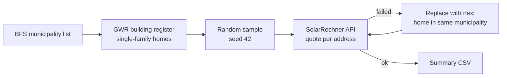

# ☀️ Swiss Residential Solar PV Costs

**Solar PV cost quotes for randomly sampled single-family homes across Switzerland**,
by canton and by municipality, taken from the federal
[SolarRechner](https://www.energieschweiz.ch/tools/solarrechner/) (EnergieSchweiz).

| Dataset | Sample | Quotes | File |
|---|---|---|---|
| 🏔️ **Municipality** | up to 10 homes × 2,110 municipalities = **21,077** | **20,932** (99.3%) | `municipality/municipality_quotes_summary.csv` |
| 🗺️ **Canton** | 3 homes × 26 cantons = **78** | **78** (100%) | `canton/solarrechner_quotes_summary.csv` |

Results as of 2026-10-23 (municipality) and 2026-10-24 (canton). SolarRechner lowered its cost
estimates between 2026-10-18 and 2026-10-23: for the same buildings and the same system size,
the gross investment dropped by 3–10% (median −8.7%), so both datasets were collected again.

---

## Contents

- [Scenario](#scenario)
- [Quick start](#quick-start)
- [How it works](#how-it-works)
- [Municipality dataset](#municipality-dataset)
- [Canton dataset](#canton-dataset)
- [Missing quotes](#missing-quotes)
- [Output columns](#output-columns)
- [Repository structure](#repository-structure)

---

## Scenario

Every quote uses the same settings:

| Setting | Value |
|---|---|
| Homes | Existing single-family houses from the federal building register (GWR): `GKLAS 1110`, `GSTAT 1004` |
| House number | Plain numbers only (`5`, not `5a` / `30.1` / `714a.99`) |
| Residents (*Bewohner im Haus*) | **4** |
| Facade planes | **Off** |
| Roof planes tilted ≥ 75° | **Off** (wall-like surfaces; 75° is the threshold of the federal tilt bonus, EnFV: *"Neigungswinkel von mindestens 75 Grad"*) |

> ✅ **Checked against the website** on 5 addresses with these settings: gross investment,
> KLEIV subsidy, tax savings and net investment are identical. Payback period, total
> balance and average return were compared on 3 addresses and are identical with the same
> number of residents (these three depend on the residents, the costs do not).
> Re-checked after the price change (2026-10-23/24): gross investment of Brunngasse 10,
> Kleinandelfingen and the full cost dialog, module area, *Nennleistung* and existing PV
> system of Oberalbisstrasse 13, Hausen am Albis are identical. The four energy columns
> are the fields the website's result table reads (checked in its frontend code).

---

## Quick start

Requires Python 3 and [`requests`](https://pypi.org/project/requests/) (`pip install requests`).
Run from the repository root:

```bash
# Municipality dataset
python municipality/build_municipality_list.py              # list of municipalities
python municipality/get_municipality_addresses.py           # sample addresses (~1-2 min)
python municipality/get_municipality_quotes.py              # quotes (several hours, resumable; run 1-2 more times)
python municipality/replace_failed_municipality_addresses.py
python municipality/finalize_municipality_quotes.py         # summary CSV + failure breakdown

# Canton dataset
python canton/get_address.py
python canton/get_solarrechner_quotes.py
python canton/summary_csv.py
```

Every script resolves its paths relative to its own location, so it can also be run from
inside its folder.

---

## How it works



### Quote requests

The scripts send the same requests as the SolarRechner website (backend: Tachion):

| # | Request | What it does |
|---|---|---|
| 1 | `api3.geo.admin.ch` SearchServer | Geocode the address; use the hit for the sampled building (EGID), otherwise the address fails |
| 2 | `/sim/attrs` | Parcel, coordinates, electricity provider and tariff; if it answers with another building (other EGID), the address fails |
| 3 | `/sim/planes` | Roof and facade planes; can include planes of other buildings on the parcel, which the website's optimization (step 4) may also select |
| 4 | `/sim/buildingReport`, `state: SOLAR_OPT` | Website's first result, on the planes as returned by step 3 |
| 5 | `/sim/buildingReport`, no state | Planes from step 4 with facades and ≥ 75° roof planes off, `occupantNumber = 4` in `signature.input` |

Steps 4–5 are the website's own sequence (read from its frontend code and confirmed with
its numbers). A single `SOLAR_OPT` call with the planes already switched off gave higher
costs in 35 of 60 tested buildings.

---

## Municipality dataset

**21,077 addresses → 20,932 quotes (99.3%).** 2,096 of 2,110 municipalities have at least
one quote, 2,091 have all 10.

<details>
<summary><b>1. Municipality list</b> — <code>build_municipality_list.py</code></summary>

Official list from BFS's
[Historicized Directory of Swiss Municipalities](https://www.agvchapp.bfs.admin.ch/).
Only name and BFS number are taken from it; the register's `Parent` field gave wrong
cantons (e.g. Horgen ZH resolved to VS), so the canton comes from the GWR data.
</details>

<details>
<summary><b>2. Address sampling</b> — <code>get_municipality_addresses.py</code></summary>

- Source: GWR public bulk download (`https://public.madd.bfs.admin.ch/<canton>.zip`),
  cached in `municipality/gwr_cache/` (~1 GB on the first run).
- Eligible: existing single-family homes with a street address and a plain house number.
- Per municipality: 10 drawn with a fixed seed (`--seed`, default 42), at most 2 per
  street, so every eligible home has the same chance of being picked.
- Municipalities that stay below 10 are filled up: first without the street limit, then
  with letter-suffixed numbers (`5a`), at most one building per base address.
- The sample was drawn from the GWR export of 2026-10-15 (kept in `gwr_cache/`); a new
  download gets the current export, which can give a different sample.

Result (seed 42): 21,077 addresses; 2,106 municipalities at 10 (12 via the fill-up
steps). Below 10: Berken BE 8, Mauraz VD 8, Lavizzara TI 1, Cerentino TI 0.
</details>

<details>
<summary><b>3. Quotes</b> — <code>get_municipality_quotes.py</code></summary>

- 20 workers by default. Measured with the earlier 4-request flow: ~8,300 addresses/hour
  (5 workers: ~5,000/h; 40 workers was barely faster and caused more server errors).
- Resumable: a re-run only retries addresses without a successful quote.
</details>

<details>
<summary><b>4. Replacement</b> — <code>replace_failed_municipality_addresses.py</code></summary>

- Replaces each failed address with the next candidate of the same municipality in the
  seeded sampling order (same rules).
- At most 5 candidates per failed address over all runs; addresses already tried are
  never tried again.
- Skips candidates in postal codes that had a missing-weather-data error.
- A valid answer without a PV system (`pvSystem.isActive` false, gross investment 0) counts
  as a failure. In the 2026-10-23 run this happened for 39 addresses (in 3 of them the 75°
  rule switched off the only selected plane); all 39 were replaced.
- One address was excluded by hand and replaced: Chemin de Montofrey 3, 1040
  Villars-le-Terroir (selected module area 0.007 m², 0.0014 kW, gross CHF 6,100).

After the first quote run 802 addresses had failed; 657 were replaced by addresses of the
same municipality that got a quote. A later check found 55 quotes (0.26%) made for another
building than the sampled one: 37 were re-quoted for the sampled building, 18 were replaced
(17 because `/attrs` answers with another building, 1 server error).

In the 2026-10-23 re-run, 13 addresses that had a quote on 2026-10-18 failed (server errors,
geocoding, `/attrs` answering with another building) and were replaced the same way.
</details>

<details>
<summary><b>5. Finalize</b> — <code>finalize_municipality_quotes.py</code></summary>

Keeps one row per address in `municipality_addresses.csv`, prints the failure breakdown,
writes `municipality_quotes_summary.csv`, and moves dropped rows to
`municipality_quote_attempts.csv`.
</details>

---

## Canton dataset

**78 addresses → 78 quotes (100%)**, 3 per canton. 4 addresses were replaced after server
errors (2026-10-18); in the 2026-10-24 re-run all 78 addresses got a quote again.

<details>
<summary><b>Scripts</b></summary>

- `canton/get_address.py`: random points inside each canton's approximate bounding box
  are checked against the GWR (`api3.geo.admin.ch` identify) until 3 single-family homes
  with a plain house number are found.
- `canton/get_solarrechner_quotes.py`: quotes every address; failures are retried, and
  an address that still fails is replaced by a fresh random address in the same canton
  (same address rules). `--retry` re-attempts only failed rows.
- `canton/summary_csv.py`: writes the summary CSV.
</details>

---

## Missing quotes

The 145 municipality-level addresses without a quote all fail on Tachion's server:

| Error | Addresses | What was checked |
|---|---:|---|
| 🌦️ Missing weather data (`readMeteodataFile`) | 133 | The missing file is `CH<PLZ>.met` for the address's postal code (14 postal codes among the final failures; 20 seen in all runs); the server picks it from `attrs.plz4`. No address in these postal codes got a quote. 12 municipalities have only such a postal code (e.g. Yens, Brüttelen, Montfaucon); Les Enfers and Saint-Brais have no other homes left. |
| 🧱 `buildingReport` error (`null` / NullPointerException) | 11 | All have no wall data in `/planes`; every such building tested failed (77 of 77). In Collonges VS no tested building has wall data (60 tried); the website gives no quote there either (1 address checked). |
| 📐 `BUILDING_TOO_BIG` (`/planes`) | 1 | Not related to building size (median footprint 107 m² vs 108 m² for successful ones). In 37 of 38 tested cases no roof plane lies inside the parcel returned by `/attrs`. |

---

## Output columns

| Column | Meaning |
|---|---|
| `canton`, `municipality`, `bfs_code`, `address`, `plz` | Sampled address (`bfs_code` in the municipality dataset only) |
| `buildingGroundArea_sqm` | Building footprint from Tachion (QC) |
| `installedArea_sqm` | Total module area of the selected PV planes (*Modulfläche*, summed over planes) |
| `nominalPower_kW` | PV capacity as the website shows it (*Nennleistung, kW*, shown per roof surface there): module area × 0.2 kW/m² (PV efficiency 20%), summed over the selected surfaces. Not Tachion's `pvSystem.nominalPower`, which is lower for buildings with an existing PV system |
| `existingPV_kW` | Existing PV system at the address according to SolarRechner (*Bereits bestehende Solarsysteme*); empty if none. The website deducts its area share in the cost calculation |
| `grossInvest_CHF` | Investment incl. VAT for the PV system, without battery (*Investitionskosten Solar*) |
| `subsidies_CHF` | One-time federal subsidy (*Kleine Einmalvergütung KLEIV*) |
| `netInvest_CHF` | Gross investment − KLEIV − tax savings (*Nettoinvestition*) |
| `paybackTime_years` | Payback period (*Amortisationsdauer*); depends on the residents through self-consumption |
| `producedKwhYear_kWh` | Annual solar production (*Produzierter Solarstrom*) |
| `selfConsumedKwhYear_kWh` | Self-consumed solar electricity per year |
| `selfConsumptionPct_pct` | Self-consumption ratio (*Eigenverbrauchsanteil*) |
| `gridFeedinKwhYear_kWh` | Electricity fed into the grid per year |

The full CSVs (`*_quotes.csv`) additionally have `egid`, `roofPlanesFound` /
`roofPlanesSelected` (roof planes after the tilt rule), `error` (server or request error,
empty if the quote succeeded) and `raw_json` (attrs, parameters, cost analysis and energy
results of the final request, plus `steep_roof_planes_off`: ids of the planes switched off
by the 75° rule).

---

## Repository structure

```
canton/
├── get_address.py                          sample 3 homes per canton
├── get_solarrechner_quotes.py              quotes (+ replacement within the canton)
├── summary_csv.py                          summary CSV
├── random_addresses.csv                    sampled addresses
├── solarrechner_quotes.csv                 full results incl. raw_json
└── solarrechner_quotes_summary.csv         summary
municipality/
├── build_municipality_list.py              1. municipality list (BFS)
├── get_municipality_addresses.py           2. sample from the GWR bulk download
├── get_municipality_quotes.py              3. quotes (resumable)
├── replace_failed_municipality_addresses.py  4. replace failed addresses
├── finalize_municipality_quotes.py         5. one row per address + summary CSV
├── repair_quotes_csv.py                    utility: fix a CSV cut off by an interrupted run (--fix)
├── all_municipalities.csv                  2,110 municipalities
├── municipality_addresses.csv              sampled addresses (after replacement)
└── municipality_quotes_summary.csv         summary
```

Not in the repository (gitignored, large or local): `municipality/municipality_quotes.csv`
(full results with raw_json, ~480 MB), `municipality/municipality_quote_attempts.csv`
(quote rows of replaced addresses), `municipality/gwr_cache/` (GWR downloads, ~0.9 GB).

---

<sub>Data sources: [SolarRechner](https://www.energieschweiz.ch/tools/solarrechner/) (EnergieSchweiz),
[GWR](https://www.housing-stat.ch/) and [geo.admin.ch](https://api3.geo.admin.ch/) (federal geodata),
[BFS municipality directory](https://www.agvchapp.bfs.admin.ch/).</sub>
